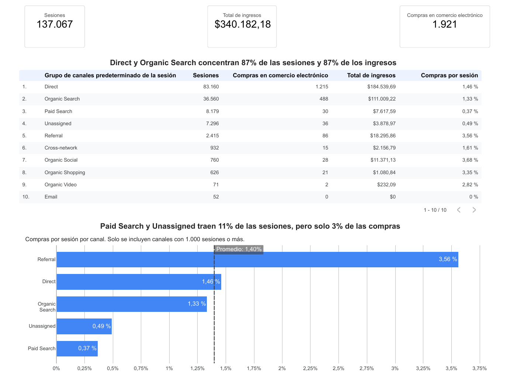
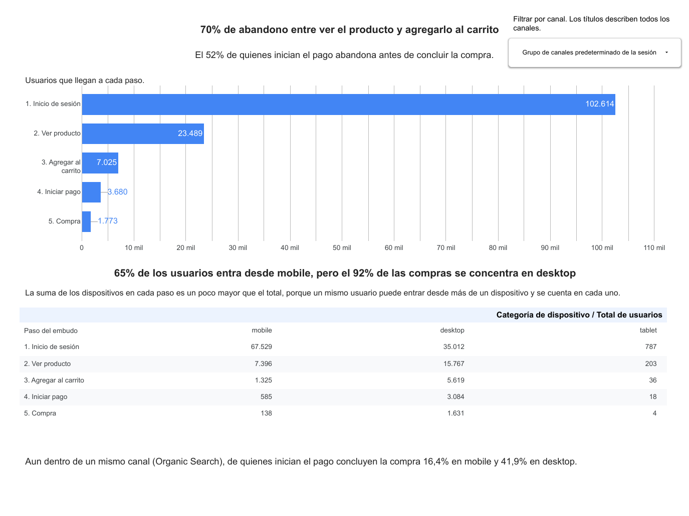
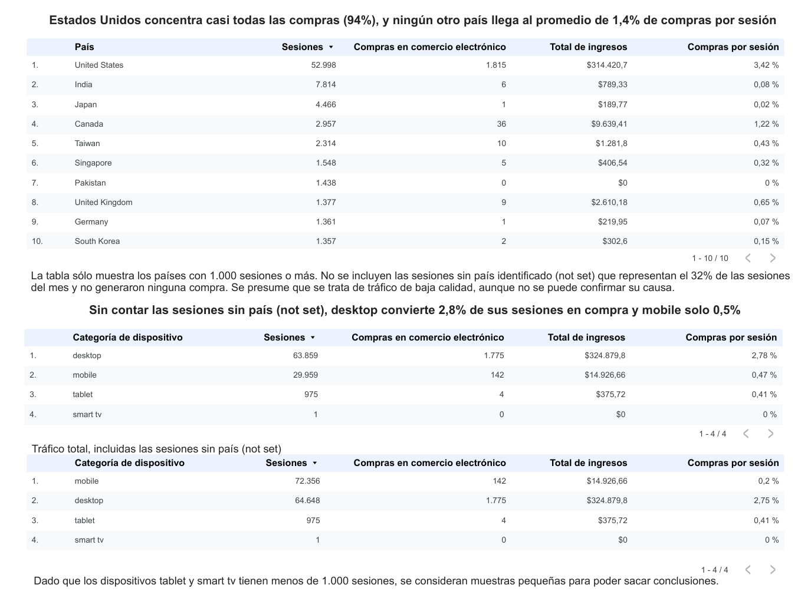

# Google Merchandise Store · Análisis de marketing digital (GA4 + Looker Studio)

🇬🇧 [Read in English](README.md)

**¿En qué canales, dispositivos y países debe enfocarse el marketing? ¿Y dónde abandonan las personas antes de comprar?**

Un caso de negocio simulado con la cuenta de demostración pública de GA4 de la Google Merchandise Store (1 al 30 de septiembre de 2026): 137.067 sesiones, 1.921 compras e ingresos de USD 340.182. Definí tres preguntas de negocio, analicé los datos en Google Analytics 4, construí un dashboard de tres páginas en Looker Studio (en español y en inglés) y escribí un resumen ejecutivo con recomendaciones para una directora de marketing.

## 🔗 Dashboards en vivo

| Idioma | Enlace |
|---|---|
| Español | [Abrir el dashboard](https://datastudio.google.com/s/nOQR1zB3rPA) |
| English | [Open the dashboard](https://datastudio.google.com/s/nDGLvODaLdo) |

Copias estáticas: [`dashboards/dashboard_ES.pdf`](dashboards/dashboard_ES.pdf) · [`dashboards/dashboard_EN.pdf`](dashboards/dashboard_EN.pdf)

## 🎯 Mensaje principal

> **El 94% de las compras proviene de Estados Unidos, a pesar de que hay países con muchas sesiones y casi ninguna compra. Conviene verificar a qué países envía la tienda antes de decidir las acciones de marketing. Además, solo 24% de los usuarios que inician el pago en mobile finaliza la compra, frente a 53% en desktop; se recomienda probar el pago en mobile y compararlo con desktop para identificar la causa.**

Resumen ejecutivo completo con recomendaciones: [`docs/resumen_ejecutivo_ES.md`](docs/resumen_ejecutivo_ES.md) · [`docs/executive_summary_EN.md`](docs/executive_summary_EN.md)

## 📊 Vista previa del dashboard

**Página 1 · Canales**


**Página 2 · Embudo de compra**


**Página 3 · Dispositivo y país**


## ❓ Preguntas de negocio y qué encontré

1. **¿Qué canales generan más compras e ingresos, y cuáles traen muchas sesiones con pocas compras?**
   Direct y Organic Search traen 87% de las sesiones y 87% de los ingresos. Paid Search y Unassigned traen 11% de las sesiones, pero solo 3% de las compras.
2. **¿En qué paso del recorrido de compra abandonan más las personas?**
   De quienes ven un producto, 70% no lo agrega al carrito; de quienes inician el pago, 52% no compra. De quienes inician el pago, compra 24% en mobile y 53% en desktop, y la brecha se mantiene dentro de un mismo canal.
3. **¿Qué dispositivos y países generan más compras, en total y en proporción a sus sesiones?**
   Estados Unidos concentra 94% de las compras. Sin contar las sesiones sin país, desktop convierte 2,8% de sus sesiones en compra y mobile 0,5%.

**Hallazgo inesperado:** 32% de las sesiones no tiene país identificado ("not set"), no generó ninguna compra y casi todas son de Direct + mobile. Inflan las sesiones, no las compras ni los ingresos; por eso el dashboard las excluye al comparar dispositivos y países y lo avisa en la página.

## 🧰 Herramientas y habilidades

- **Google Analytics 4:** informes, canales de adquisición, recorrido de compra, exploración de una cuenta demo.
- **Looker Studio:** conexión a la fuente de datos, campos calculados (`CASE`, compras por sesión), filtros por gráfico, tarjetas, tablas, tabla dinámica, gráficos de barras con línea de referencia, control de lista desplegable, copia bilingüe del informe.
- **Prácticas de análisis:** validar las cifras del dashboard contra GA4, revisar el denominador de cada porcentaje, regla de muestra pequeña (menos de 1.000 sesiones), comparar dentro de niveles de otra variable (canal × dispositivo), separar hipótesis de conclusiones, documentar problemas de calidad de datos.

## 📁 Contenido del repositorio

```
├── README.md / README.es.md          Este archivo (inglés / español)
├── dashboards/                       Exportación PDF del dashboard (EN, ES)
├── images/                           Capturas de cada página (EN, ES)
└── docs/
    ├── executive_summary_EN.md       Resumen ejecutivo en inglés
    ├── resumen_ejecutivo_ES.md       Resumen ejecutivo con recomendaciones
    └── data_quality_log.md           Hallazgos de calidad de datos y decisiones (EN + ES)
```

## ⚠️ Limitaciones (versión corta)

Cuenta demo con cifras redondeadas y sin costos de publicidad ni de productos, así que ingresos no es ganancia y no se evalúa rentabilidad. Solo hay un mes de datos, por lo que no se puede confirmar estacionalidad ni tendencias. GA4 muestra **dónde** ocurre una diferencia, no **por qué**: las causas mencionadas son hipótesis. El selector de canal de la página 2 del informe en inglés muestra su nombre de campo en español, porque Looker Studio conserva el nombre guardado en la fuente de datos. La lista completa está en [`docs/data_quality_log.md`](docs/data_quality_log.md).

## 🚀 Próximos pasos

Conseguir el costo de los anuncios; confirmar a qué países envía la tienda; revisar en GA4 los pasos dentro del pago; analizar varios meses para confirmar tendencias; revisar qué sitios generan el tráfico de Referral; repetir el análisis con los datos de GA4 en BigQuery (SQL).

---

**Autora:** Dámaris Cubos Rosas · [GitHub](https://github.com/damaris-cubos-rosas)
