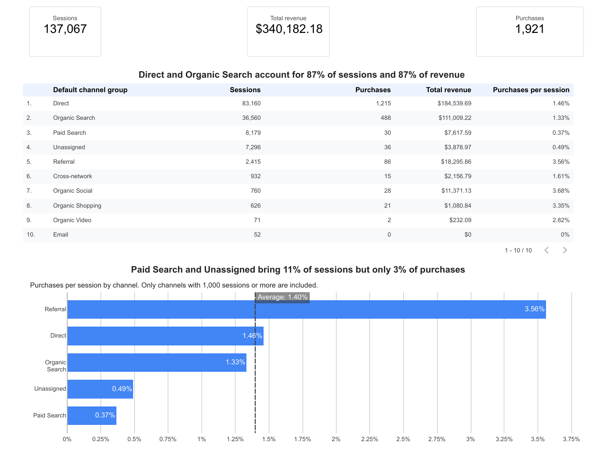
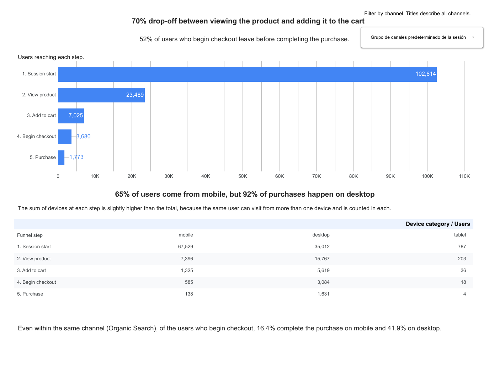
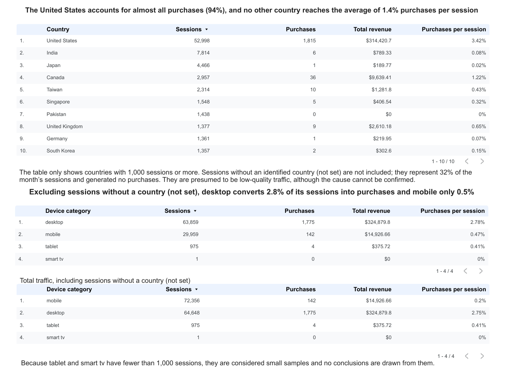

# Google Merchandise Store · Digital Marketing Analysis (GA4 + Looker Studio)

🇪🇸 [Leer en español](README.es.md)

**Which channels, devices and countries should marketing focus on? And where do people drop off before buying?**

A simulated business case built on the public GA4 demo account of the Google Merchandise Store (September 1–30, 2026): 137,067 sessions, 1,921 purchases, USD 340,182 in revenue. I defined three business questions, analyzed the data in Google Analytics 4, built a three-page dashboard in Looker Studio (in Spanish and English), and wrote an executive summary with recommendations for a marketing director.

## 🔗 Live dashboards

| Language | Link |
|---|---|
| English | [Open the dashboard](https://datastudio.google.com/s/nDGLvODaLdo) |
| Español | [Abrir el dashboard](https://datastudio.google.com/s/nOQR1zB3rPA) |

Static copies: [`dashboards/dashboard_EN.pdf`](dashboards/dashboard_EN.pdf) · [`dashboards/dashboard_ES.pdf`](dashboards/dashboard_ES.pdf)

## 🎯 Key message

> **94% of purchases come from the United States, even though some countries have many sessions and almost no purchases. The store should confirm which countries it ships to before deciding on marketing actions. In addition, only 24% of users who begin checkout on mobile complete the purchase, versus 53% on desktop; testing the checkout on mobile and comparing it with desktop is recommended to find the cause.**

Full executive summary with recommendations: [`docs/executive_summary_EN.md`](docs/executive_summary_EN.md) · [`docs/resumen_ejecutivo_ES.md`](docs/resumen_ejecutivo_ES.md)

## 📊 Dashboard preview

**Page 1 · Channels**


**Page 2 · Purchase funnel**


**Page 3 · Devices and countries**


## ❓ Business questions and what I found

1. **Which channels generate the most purchases and revenue, and which bring many sessions but few purchases?**
   Direct and Organic Search bring 87% of sessions and 87% of revenue. Paid Search and Unassigned bring 11% of sessions but only 3% of purchases.
2. **At which step of the purchase journey do people drop off the most?**
   70% of people who view a product do not add it to the cart; 52% of people who begin checkout do not buy. Of those who begin checkout, 24% buy on mobile and 53% on desktop, and the gap holds within a single channel.
3. **Which devices and countries generate the most purchases, in total and relative to their sessions?**
   The United States accounts for 94% of purchases. Excluding sessions without a country, desktop converts 2.8% of its sessions into purchases and mobile 0.5%.

**Unexpected finding:** 32% of sessions have no identified country ("not set"), generated no purchases at all, and are almost all Direct + mobile. They inflate sessions, not purchases or revenue, so the dashboard excludes them when comparing devices and countries and says so on the page.

## 🧰 Tools and skills

- **Google Analytics 4:** reports, acquisition channels, purchase journey, exploration of a demo account.
- **Looker Studio:** data source connection, calculated fields (`CASE`, purchases per session), chart-level filters, scorecards, tables, pivot table, bar charts with reference line, dropdown control, bilingual report copy.
- **Analysis practices:** validating dashboard figures against GA4, checking the denominator of every percentage, small-sample rule (fewer than 1,000 sessions), comparing within levels of another variable (channel × device), separating hypotheses from conclusions, documenting data-quality issues.

## 📁 Repository contents

```
├── README.md / README.es.md          This file (English / Spanish)
├── dashboards/                       PDF export of the dashboard (EN, ES)
├── images/                           Page screenshots (EN, ES)
└── docs/
    ├── executive_summary_EN.md       Executive summary with recommendations
    ├── resumen_ejecutivo_ES.md       Resumen ejecutivo con recomendaciones
    └── data_quality_log.md           Data-quality findings and decisions (EN + ES)
```

## ⚠️ Limitations (short version)

Demo account with rounded figures and no advertising or product costs, so revenue is not profit and profitability is not assessed. Only one month of data, so seasonality and trends cannot be confirmed. GA4 shows **where** a difference occurs, not **why**: the causes mentioned are hypotheses. The channel dropdown on page 2 of the English report shows its field name in Spanish, because Looker Studio keeps the name stored in the data source. See [`docs/data_quality_log.md`](docs/data_quality_log.md) for the complete list.

## 🚀 Next steps

Obtain advertising costs; confirm which countries the store ships to; review the steps inside checkout in GA4; analyze several months to confirm trends; review which sites generate Referral traffic; repeat the analysis with GA4 data in BigQuery (SQL).

---

**Author:** Dámaris Cubos Rosas · [GitHub](https://github.com/damaris-cubos-rosas)
